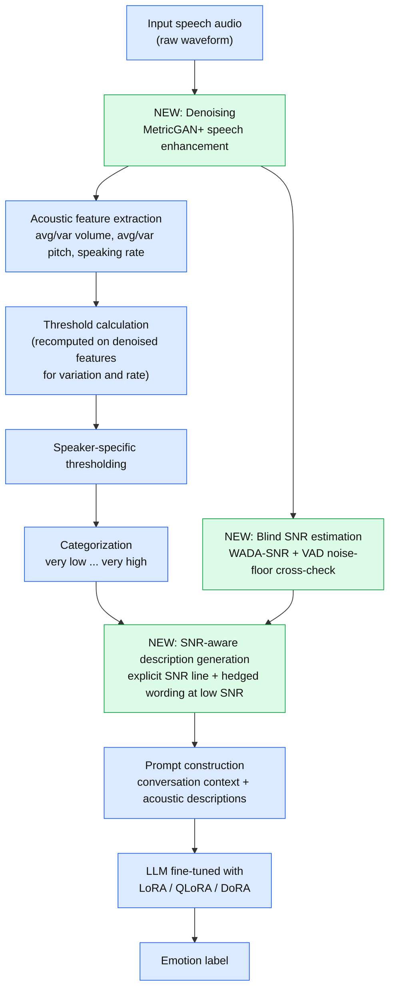

# Denoising and SNR-Aware SpeechCueLLM for Robust Speech Emotion Recognition

Reproduction and extension of **SpeechCueLLM** on IEMOCAP and MELD, with a speech-enhancement front-end, SNR-aware acoustic descriptions, and a parameter-efficient fine-tuning (PEFT) comparison.

**Status:** Phase 1 (reproduction) and Phase 2 (denoising diagnostic) complete. Phases 3 to 6 pending.

## 1. Paper Being Replicated

**Title:** Beyond Silent Letters: Amplifying LLMs in Emotion Recognition with Vocal Nuances (SpeechCueLLM)
**Authors:** Wu et al.
**Venue:** Findings of ACL: NAACL 2025
**Paper:** https://aclanthology.org/2025.findings-naacl.117/
**Official code:** https://github.com/zehuiwu/SpeechCueLLM

## 2. Project Idea

SpeechCueLLM turns five acoustic measurements (average volume, volume variation, average pitch, pitch variation, speaking rate) into categorical natural-language descriptions and adds them to the prompt of a LoRA-fine-tuned LLM. The paper reports clear gains on clean IEMOCAP but only marginal or negative gains on noisy MELD, and lists noisy audio as future work.

The pipeline is rule-based and assumes the acoustic measurements are reliable. On noisy audio they are not, yet the description still sounds confident. We address this with two connected contributions:

1. **Denoising + SNR-aware descriptions:** clean the audio with MetricGAN+, estimate per-utterance SNR (WADA-SNR), and tell the LLM how reliable each description is (explicit SNR line plus hedged wording at low SNR).
2. **PEFT comparison:** QLoRA, LoRA rank sweep (r = 4, 8, 16, 32) and DoRA on top of the improved pipeline.

### Research questions

- **RQ1:** Can the official implementation and baseline behaviour be reproduced on available hardware?
- **RQ2:** Does a denoising front-end improve performance on noisy MELD and on degraded IEMOCAP?
- **RQ3:** Can blind SNR estimates modulate the descriptions and improve emotion recognition under degraded audio?
- **RQ4:** Which PEFT method gives the best accuracy per trainable parameter and per GB of GPU memory?
- **RQ5:** Does the combined pipeline improve robustness without materially raising cost?

## 3. Pipeline

Blue boxes are the original SpeechCueLLM stages; green boxes are our additions.



## 4. Phases and Progress

| Phase | Description | Status |
|---|---|---|
| 1 | Reproduce SpeechCueLLM baseline (B0, B1) | Done (IEMOCAP, 3B backbone) |
| 2 | MetricGAN+ front-end and feature-distribution diagnostic | Done (1000-clip samples) |
| 3 | Blind SNR estimation (WADA-SNR) | Pending |
| 4 | SNR-aware description generation | Pending |
| 5 | PEFT comparison (QLoRA, rank sweep, DoRA) | Pending |
| 6 | Ablations and robustness (clean / mild / moderate / severe noise) | Pending |

## 5. Team and Contributions

| Member | Roll No. | Focus |
|---|---|---|
| Utkarsh Umap | B24CS049 | Phi-3 mini baseline reproduction (B0 and B1 on IEMOCAP and MELD)
 |
| Kaif Raza | B24DS017 | MetricGAN+ denoising front-end and raw-vs-denoised feature diagnostic |
| Kushal Agarwal | B24DS012 | LLaMA-3.2-3B LoRA baseline reproduction (B0 and B1 on IEMOCAP) |

## 6. Repository Structure

```
.
├── denoised dataset/           # Phase 2 raw-vs-denoised feature data
│   ├── iemocap_raw_vs_den.csv
│   ├── meld_raw_vs_den.csv
│   └── __huggingface_repos__.json
├── docs/
│   ├── figures/
│   ├── phase1-2-progress-report.docx
│   ├── project-presentation.pptx
│   └── sop.pdf
├── notebooks/
│   ├── Phi-3-mini-4k-instruct_with-desc.py
│   ├── Phi-3-mini-4k-instruct_without-desc.py
│   ├── denoising.ipynb
│   ├── denoising_result.ipynb
│   ├── iemocap_llama3.2_3B_instruct_with_desc.ipynb
│   └── iemocap_llama3.2_3B_instruct_without_desc.ipynb
├── results/
│   ├── llama32_3b_lora/
│   │   ├── iemocap_with_desc.txt
│   │   └── iemocap_without_desc.txt
│   ├── phase2_diagnostic/
│   │   ├── distributions.png
│   │   ├── shift_iemocap.csv
│   │   ├── shift_meld.csv
│   │   ├── threshold_agreement_iemocap.csv
│   │   └── threshold_agreement_meld.csv
│   └── phi3_fullft/
│       ├── iemocap_with_desc.json
│       ├── iemocap_without_desc.json
│       ├── meld_with_desc.json
│       ├── meld_without_desc.json
│       ├── metrics.json
│       └── logs/
│           ├── b0_text_only.kaggle.log
│           └── b1_speech_descriptions.kaggle.log
├── .gitignore
├── LICENSE
├── README.md
└── requirements.txt
```

## 7. Resources Required

- **Datasets:** IEMOCAP and MELD, obtained through their official channels .
- **Compute:** Kaggle notebooks, 2x NVIDIA T4 (about 30 GPU hours per week, 12 h sessions). Denoising and feature extraction ran on CPU.
- **Models:** LLaMA-3.2-3B-Instruct and Phi-3-mini for the Phase 1 baselines; SpeechBrain `speechbrain/metricgan-plus-voicebank` for the Phase 2 denoising front-end.

## 8. Code Setup

### 8.1 LLaMA-3.2-3B notebooks

```bash
git clone https://github.com/UtkarshUmap/SpeechcueLLM_Reproduce
cd SpeechcueLLM_Reproduce
git clone https://github.com/zehuiwu/SpeechCueLLM.git
pip install -r requirements.txt
pip install speechbrain opensmile praat-parselmouth
```

The LLaMA baseline notebooks use the upstream SpeechCueLLM repository and
require the patches listed in Section 8.3. Run them in Kaggle with two NVIDIA
T4 GPUs and IEMOCAP available to the upstream data-preparation script.

### 8.2 Phi-3 Mini scripts

The two Phi-3 scripts in `notebooks/` are designed to run as cells in a Kaggle
notebook. They install their Python dependencies, clone SpeechCueLLM into
`/kaggle/working`, and prepare the processed dataset splits. Run them in Kaggle
with internet access, two NVIDIA T4 GPUs, and access to MELD and IEMOCAP.
Attach or stage the raw datasets where the upstream `data_process.py` script
expects them; the Phi-3 scripts do not include the datasets. IEMOCAP requires
a license request. KaggleHub checkpoint and final-model uploads are enabled
by default; configure Kaggle authentication for these uploads, or disable
`UPLOAD_CHECKPOINTS` and `UPLOAD_FINAL` before running.

### 8.3 Patches to the official repo

The LLaMA notebooks use a newer library stack (Python 3.13 with recent peft,
deepspeed, and transformers) and T4 GPUs, so the upstream repository needed
these changes:

- load the model in fp16 with `low_cpu_mem_usage`, and force fp16 instead of bf16 for LLaMA (T4 has no bf16);
- call `enable_input_require_grads` when gradient checkpointing is on;
- drop empty optimizer parameter groups;
- remove the `mics_shard_size` keys that newer DeepSpeed rejects;
- add `--gradient_checkpointing` to the launch shell script;
- uninstall `torchao` (conflicts with peft) and install `opensmile` (imported by `data_utils`);
- use DeepSpeed ZeRO-2 instead of ZeRO-3 for the 3B model.

**Launch note:** do not call `os._exit(0)` in a Kaggle commit run. It kills the kernel, marks the version failed and loses the final training history. Save results and logs to files from the launch cell and kill hung processes only after the final history line.

### 8.4 Deviations from the paper

| Item | Paper | This project |
|---|---|---|
| Backbone | LLaMA-2-7B / LLaMA-3-8B | LLaMA-3.2-3B-Instruct |
| Precision | bf16 | fp16 |
| GPUs | larger cards | 2x T4 |
| Epochs | 15 | 3 to 5 (B0 peaks at epoch 3) |
| Seeds | mean of 3 runs | single seed (11) |

The 3B backbone is used because a 7B run with ZeRO-3 took about 6.45 s/step and hit the 12 h session limit; the 3B model is about 10x faster.

## 9. Training and Evaluation

### 9.1 LLaMA-3.2-3B LoRA baselines (IEMOCAP)

These settings apply to the LLaMA notebooks and results in Section 10.2; they
do not describe the Phi-3 runs.

| Item | Value |
|---|---|
| Model | LLaMA-3.2-3B-Instruct |
| Dataset | IEMOCAP, six classes (happy, sad, neutral, angry, excited, frustrated) |
| Method | LoRA, r = 16, alpha = 16, q/k/v projections |
| Learning rate | 3e-4 |
| Effective batch size | 16 (accumulation 8 x 2 GPUs) |
| Max length / history window | 2500 tokens / 12 utterances |
| Epochs / seed | B0: 5; B1: 3; seed 11 |
| Hardware / precision | 2x NVIDIA T4, FP16, DeepSpeed ZeRO-2 |
| Runtime | about 35 min/epoch + about 6 min eval (B1) |
| B0 flags | `audio_description=False`, `audio_context=False` |
| B1 flags | `audio_description=True`, `audio_context=True`, `impression=False` |

Run the matching IEMOCAP notebook in `notebooks/` after cloning and patching
the upstream repository as described in Section 8.1. The notebook prepares
the matching B0 or B1 data and launches training. Evaluation is test weighted
F1 per epoch; both GPU processes report scores for the full test split.

### 9.2 Phi-3 Mini full-finetuning baselines (MELD and IEMOCAP)

These settings apply to the two Phi-3 scripts in `notebooks/` and the results
in Section 10.3. B0 is text-only; B1 adds speech descriptions. Both variants
disable audio context.

| Item | Value |
|---|---|
| Model | `microsoft/Phi-3-mini-4k-instruct` |
| Method | Full fine-tuning; PyTorch FSDP `FULL_SHARD` |
| Precision / optimizer | FP16 / bitsandbytes AdamW8bit |
| Hardware | 2x NVIDIA T4 |
| Per-GPU batch / gradient accumulation | 1 / 4 steps |
| Effective global batch size | 8 |
| Epochs / seed | 1 / 42 |
| Learning rate | 2e-5 |
| Maximum sequence length | MELD: 512; IEMOCAP: 384 |
| Shared preprocessing | Historical window 12; audio impression, audio-only mode, and audio context disabled |
| B0 script | `Phi-3-mini-4k-instruct_without-desc.py` (`audio_description=False`) |
| B1 script | `Phi-3-mini-4k-instruct_with-desc.py` (`audio_description=True`) |

#### Reproducing the Phi-3 runs

1. Create a Kaggle notebook with internet access and a two-T4 GPU
   accelerator. Make sure you are authorized to access MELD and IEMOCAP;
   IEMOCAP requires a license request. Attach or stage both raw datasets in
   the locations expected by upstream SpeechCueLLM's `data_process.py`.
2. Copy the contents of the B0 script from `notebooks/` into a Kaggle code
   cell and run it. These scripts contain Kaggle's `%pip` notebook magic and
   are not ordinary standalone Python scripts. Each installs its dependencies,
   clones SpeechCueLLM into `/kaggle/working`, and invokes the upstream
   preparation code with its configured `audio_description` setting.
3. After B0 finishes, repeat with the B1 script in a fresh cell or notebook.
4. Let each script run both datasets. Each launches MELD with maximum
   sequence length 512 and IEMOCAP with maximum sequence length 384 in
   separate distributed processes. Do not run both scripts simultaneously on
   the same GPUs.
5. The scripts report validation and test accuracy, macro F1, weighted F1,
   and unknown-prediction counts. B0 outputs are written under
   `/kaggle/working/phi3_speechcuelm_nodesc_outputs/`; B1 outputs are written
   under `/kaggle/working/phi3_speechcuelm_outputs/`. Download any summaries,
   logs, or final models to keep before the Kaggle session ends.
6. KaggleHub checkpoint and final-model uploads are enabled by default.
   Configure Kaggle authentication and access to the configured Kaggle
   datasets for uploads; otherwise, disable the upload flags before running.

### 9.3 Phase 2: denoising diagnostic

1. Convert MELD mp4 clips to 16 kHz mono wav with ffmpeg; use IEMOCAP sentence wavs directly (skip macOS `._` files).
2. Sample 1000 clips per dataset (seed 0).
3. Run MetricGAN+ on CPU, then extract the five features with the repo's Praat/parselmouth extractor on raw and denoised audio.
4. Compare distributions (median shift, Spearman, KS) and frozen vs recomputed thresholds.

Outputs (`meld_raw_vs_den.csv`, `iemocap_raw_vs_den.csv`, shift/threshold CSVs, `distributions.png`) are in `results/` and were originally stored as the Kaggle dataset `speechcuellm-denoise-diag`.

## 10. Results

### 10.1 Paper reference (LoRA, LLaMA-2-7B, weighted F1)

| Setting | Text only | + descriptions | + descriptions with context |
|---|---|---|---|
| IEMOCAP | 70.11 ± 0.36 | 72.02 ± 0.54 | 72.6 ± 0.26 |
| MELD | 67.44 | 67.07 | 67.1 (impressions: 67.6) |

### 10.2 Our Phase 1 results (LLaMA-3.2-3B-Instruct, IEMOCAP, seed 11)

Each GPU process scores the full test set, so two values per epoch are reported.

| Run | Epoch 1 | Epoch 2 | Epoch 3 | Epoch 4 | Epoch 5 |
|---|---|---|---|---|---|
| B0 text only, process 0 | 58.586 | 65.752 | 67.861 | 67.735 | 66.333 |
| B0 text only, process 1 | 59.134 | 64.574 | 67.491 | 66.779 | 67.090 |
| B1 descriptions + context, process 0 | 60.960 | 67.005 | 68.052 | n/a | n/a |
| B1 descriptions + context, process 1 | 61.610 | 67.244 | 67.055 | n/a | n/a |

| Run | Best epoch (mean of 2 processes) | Epoch-3 mean |
|---|---|---|
| B0 (5 epochs) | 67.68 | 67.68 |
| B1 (3 epochs) | 67.65 | 67.55 |

**Takeaway:** on the 3B model we do not observe the paper's +1.4 to +1.9 F1 gain from descriptions. The two GPU processes differ by up to about 1.0 F1, which is larger than the effect, and B0 (5 epochs) vs B1 (3 epochs) used different LR schedules, so a matched 3-epoch B0 run is needed for a fair comparison.

### 10.3 Phi-3-mini results (teammate, IEMOCAP and MELD)

The following single-run test results are from Phi-3 Mini full fine-tuning. B0 uses text-only prompts; B1 includes speech descriptions without audio context.

| Model | Dataset | Setting | Test weighted F1 (%) |
|---|---|---|---:|
| **Phi-3-mini** | **IEMOCAP** | **text only (B0)** | **71.06** |
| **Phi-3-mini** | **IEMOCAP** | **speech descriptions (B1)** | **71.30** |
| **Phi-3-mini** | **MELD** | **text only (B0)** | **66.51** |
| **Phi-3-mini** | **MELD** | **speech descriptions (B1)** | **66.97** |

Setup: one epoch, seed 42, full fine-tuning with PyTorch FSDP full sharding and FP16 on 2x NVIDIA T4 GPUs; effective global batch size 8. Results are single runs, not multi-seed estimates.

### 10.4 MELD (LLaMA-3.2-3B)

> MELD was not trained on the 3B backbone for lack of time. Any figure placed here must be clearly labeled as an estimate, not a measured result: TBD.

### 10.5 Phase 2: raw vs denoised features

Median shift after MetricGAN+, with Spearman rank correlation and KS statistic (1000 clips per dataset):

| Feature | MELD shift | MELD Spearman | MELD KS | IEMOCAP shift | IEMOCAP Spearman | IEMOCAP KS |
|---|---|---|---|---|---|---|
| Volume (avg) | +17.0% | 0.346 | 0.842 | +23.8% | 0.124 | 0.822 |
| Volume variation | +41.1% | 0.414 | 0.446 | +20.9% | 0.626 | 0.348 |
| Pitch (avg) | +1.9% | 0.810 | 0.032 | +11.5% | 0.749 | 0.163 |
| Pitch variation | +3.6% | 0.460 | 0.065 | +21.5% | 0.294 | 0.191 |
| Speaking rate | +6.7% | 0.424 | 0.146 | +8.1% | 0.455 | 0.146 |

**Findings**

- The average-volume shift is enhancer gain, not information loss: after subtracting each clip's RMS gain change the Spearman is 0.995 (MELD) and 1.0 (IEMOCAP). Level-matching the denoised audio to the raw RMS with frozen thresholds gives 97.2% (MELD) and 99.2% (IEMOCAP) same-bucket agreement.
- Average pitch is the most stable feature on MELD.
- Pitch variation, volume variation and speaking rate change substantially.
- Clean IEMOCAP changes about as much as noisy MELD, so part of the change is likely denoiser artifact (hypothesis; no clean/noisy ground truth).
- Cost: about 0.058 s/clip for the denoiser on CPU, about 0.5 s/clip including ffmpeg and both feature extractions.

**Threshold decision** (same-bucket agreement with raw categories, frozen / recomputed; chance = 31.5%):

| Feature | MELD | IEMOCAP |
|---|---|---|
| Volume (avg) | 11.0 / 37.4 | 10.6 / 35.9 |
| Volume variation | 23.8 / 44.3 | 28.0 / 48.2 |
| Pitch (avg) | 67.2 / 67.5 | 56.7 / 55.6 |
| Pitch variation | 49.2 / 52.1 | 40.9 / 44.5 |
| Speaking rate | 35.4 / 42.3 | 40.7 / 43.4 |

Recompute thresholds for volume variation, pitch variation and speaking rate; either choice works for average pitch; for average volume, level-match instead of recomputing.

## 11. Limitations

- Single seed; the paper averages 3 runs.
- Best-epoch selection uses the evaluation set (optimistic; the original repo does the same), so report best and last epoch.
- Two GPU processes give different F1 for the same epoch; cause not yet explained.
- Phase 1 baselines use a 3B backbone, so absolute numbers are not comparable to the paper.
- Phase 2 uses global (not speaker- or gender-specific) thresholds and 1000-clip samples.
- Downstream F1 with denoised features (B2) has not been measured, so the benefit of denoising is not yet shown.

## 12. Pending Work

1. Matched 3-epoch B0 run, a second seed, and MELD training.
2. B2/B3: train on denoised (optionally level-matched) features with the threshold decisions above.
3. Phases 3 and 4: WADA-SNR estimation, dataset-specific SNR bands, SNR-aware hedged descriptions.
4. Phase 5: QLoRA, LoRA rank sweep (r = 4, 8, 16, 32), DoRA.
5. Phase 6: robustness across clean, mild, moderate and severe noise with ΔF1 = F1(clean) − F1(degraded).

## 13. Reference

[1] Z. Wu et al., "Beyond Silent Letters: Amplifying LLMs in Emotion Recognition with Vocal Nuances," Findings of NAACL 2025.
