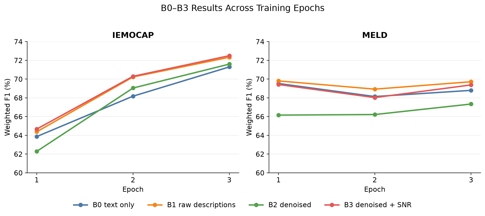
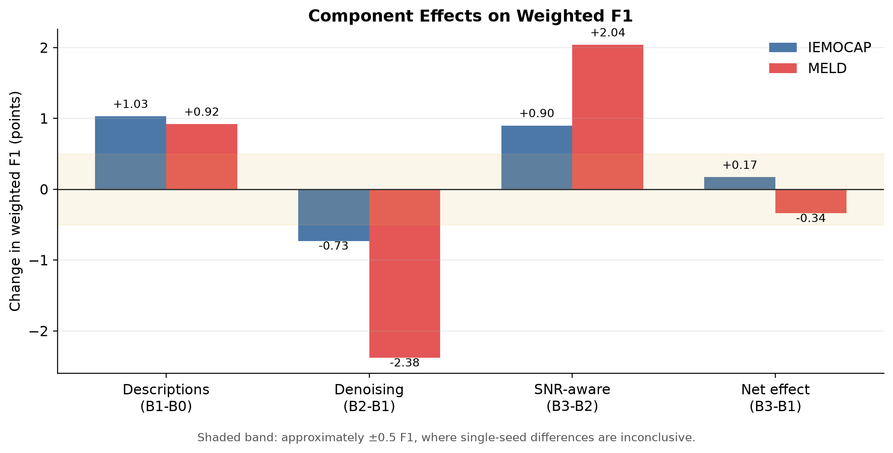
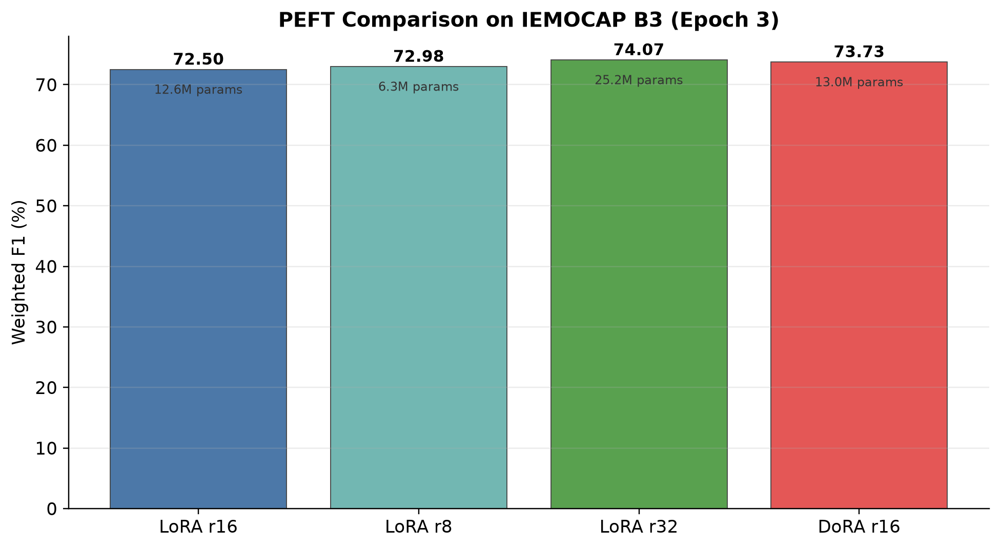
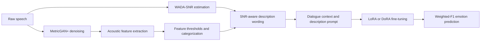

# Denoising and SNR-Aware SpeechCueLLM

Reproduction and extension of **SpeechCueLLM** for robust speech emotion recognition on IEMOCAP and MELD. The project reproduces acoustic-description prompting, adds MetricGAN+ denoising and blind WADA-SNR awareness, and compares LoRA and DoRA parameter-efficient fine-tuning.

**Final report:** [`docs/report/SpeechCueLLM_Final_Report.pdf`](docs/report/SpeechCueLLM_Final_Report.pdf)

## Project Summary

SpeechCueLLM converts five acoustic measurements into categorical text descriptions: average volume, volume variation, average pitch, pitch variation, and speaking rate. The descriptions are added to dialogue context before the LLM is fine-tuned.

This project evaluates four prompt/data configurations:

| Configuration | Description |
|---|---|
| **B0** | Text-only prompt |
| **B1** | Raw acoustic descriptions and dialogue context |
| **B2** | MetricGAN+-denoised acoustic features |
| **B3** | Denoised features with explicit SNR and hedged low-SNR wording |

## Experimental Results

All results below are from the final report and use single-seed runs. Differences below approximately 0.5 weighted-F1 points should not be interpreted as conclusive.

### LLaMA-2-7B, 4-bit QLoRA, IEMOCAP and MELD

| Configuration | IEMOCAP epoch 1 | IEMOCAP epoch 2 | IEMOCAP epoch 3 | MELD epoch 1 | MELD epoch 2 | MELD epoch 3 |
|---|---:|---:|---:|---:|---:|---:|
| B0 text only | 63.87 | 68.18 | 71.30 | 69.53 | 68.14 | 68.80 |
| B1 raw descriptions | 64.38 | 70.23 | 72.33 | 69.81 | 68.93 | 69.72 |
| B2 denoised | 62.29 | 69.05 | 71.60 | 66.16 | 66.22 | 67.34 |
| B3 denoised + SNR | 64.67 | 70.30 | 72.50 | 69.42 | 68.03 | 69.38 |

<p align="center">
  
</p>

Key findings:

- Denoising alone reduced final weighted F1 relative to B1: **0.73 points on IEMOCAP** and **2.38 points on MELD**.
- SNR-aware wording recovered most of the denoising loss: **+0.90 on IEMOCAP** and **+2.04 on MELD** relative to B2.
- B3 remained within approximately **0.4 weighted-F1 points** of raw B1 performance.

<p align="center">
  
</p>

### PEFT comparison on IEMOCAP B3

| Method | Parameters | Epoch 1 | Epoch 2 | Epoch 3 | Runtime |
|---|---:|---:|---:|---:|---:|
| LoRA r16, P1 | 12.6M | 64.67 | 70.30 | 72.50 | 16,234 s |
| LoRA r8 | 6.3M | 63.35 | 70.75 | 72.98 | 16,529 s |
| LoRA r32 | 25.2M | TBD | TBD | 74.07 | TBD |
| DoRA r16 | 13.0M | 65.03 | 71.33 | 73.73 | 20,436 s |

<p align="center">
  
</p>

LoRA r32 achieved the best completed IEMOCAP epoch-3 result at 74.07 weighted F1, versus 73.73 for DoRA r16.

## Repository Structure

```text
.
├── docs/
│   ├── README.md
│   ├── report/
│   │   └── SpeechCueLLM_Final_Report.pdf
│   └── figures/
├── notebooks/
│   ├── 01_baselines/             # Report-main LLaMA-2-7B B0 baseline
│   ├── 02_denoising/             # MetricGAN+, B2, and feature diagnostics
│   ├── 03_dataset_preparation/   # Kaggle feature and SNR preparation
│   ├── 04_snr_aware/             # MELD B3 SNR-aware experiment
│   ├── 05_peft/                  # Parameterized LoRA/DoRA and DoRA run
│   ├── 06_snr_results_pending/   # Reserved for future uploaded SNR notebooks
│   └── appendix/                 # Supplementary LLaMA-3.2-3B and Phi-3 work
├── results/
│   ├── exports/                  # Report-verified CSV result exports
│   ├── phase2_diagnostic/        # Denoising feature statistics and plots
│   ├── appendix/                 # Supplementary experiment results
│   ├── peft/                     # Additional PEFT result exports
│   └── snr_results/              # Reserved pending SNR result exports
├── scripts/
│   └── plot_results.py           # Reproducible README/result plots
├── data/
│   └── README.md                 # External dataset and storage guidance
├── requirements.txt
└── README.md
```

Completed notebooks are organized by report task rather than by upload or Kaggle edit history. No notebook was rerun during repository organization.

## Dataset Sources

The following processed Kaggle datasets are used by the later experiments:

- [`kushalag21/meld-b3`](https://www.kaggle.com/datasets/kushalag21/meld-b3)
- [`kushalag21/iemocap-with-snr`](https://www.kaggle.com/datasets/kushalag21/iemocap-with-snr)
- [`kushalag21/meld-denoised-fixed`](https://www.kaggle.com/datasets/kushalag21/meld-denoised-fixed)
- [`kushalag21/iemocap-denoised-dataset`](https://www.kaggle.com/datasets/kushalag21/iemocap-denoised-dataset)

IEMOCAP itself requires proper authorization or a license. Raw audio and large datasets are not committed to GitHub.

## Methodology



## Notable Data Preparation Finding

A MELD B2 preparation bug caused the first denoised run to produce approximately 40 weighted F1. Raw `Dialogue_ID` and `Utterance_ID` values were stored as floats, preventing speaker-helper filenames from matching the intended audio files. Rebuilding the speaker helper files from filename-derived IDs corrected the prompts and the denoised MELD result.

## Setup Notes

The experiment notebooks are primarily Kaggle artifacts and depend on:

- Kaggle-mounted datasets and model checkpoints
- The official upstream SpeechCueLLM repository
- Two NVIDIA T4-class GPUs for the main QLoRA runs
- MetricGAN+ and Praat/Parselmouth feature extraction
- Access to the official IEMOCAP and MELD releases

Base Python dependencies are listed in `requirements.txt`. Specific notebook environments may also install Kaggle-only or upstream-specific packages inside their execution cells.

## Reproducing the Work

1. Obtain authorized IEMOCAP and MELD data and the four processed Kaggle datasets listed above.
2. Clone the upstream SpeechCueLLM repository for notebooks that depend on its preprocessing and training scripts.
3. Choose the notebook matching the desired report phase in `notebooks/01_baselines` through `notebooks/05_peft`.
4. Review Kaggle paths in each notebook before execution.
5. Use the final report as the source of truth for completed configurations and results.

## Limitations

- Results are single-seed estimates.
- Main 7B runs use 4-bit QLoRA with LLaMA-2-7B on two T4 GPUs.
- LoRA r4 robustness coverage remains incomplete.
- SNR statement and hedge-word effects were not separated by an ablation.
- Level-matched denoising with recomputed thresholds was not included in the completed downstream ablation.
- GPU-memory differences did not separate the completed PEFT methods.

## Reference

Z. Wu et al., “Beyond Silent Letters: Amplifying LLMs in Emotion Recognition with Vocal Nuances,” Findings of NAACL 2025. https://aclanthology.org/2025.findings-naacl.117/

## License

A software license has not been selected because upstream datasets, notebooks, and team-authored code may have separate terms. Before public release, the team should agree on a license after checking the upstream SpeechCueLLM repository and dataset licenses.
